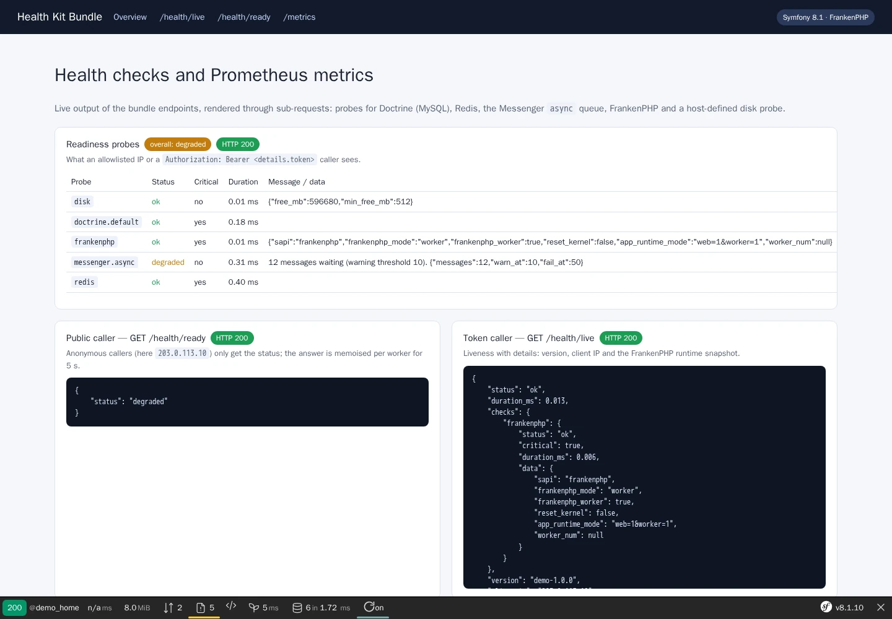
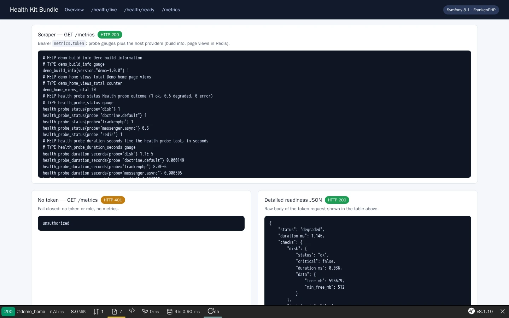

# Health Kit Bundle

[](https://github.com/nowo-tech/HealthKitBundle/actions/workflows/ci.yml) [](https://packagist.org/packages/nowo-tech/health-kit-bundle) [](https://packagist.org/packages/nowo-tech/health-kit-bundle) [](LICENSE) [](https://php.net) [](https://symfony.com) [](https://github.com/nowo-tech/HealthKitBundle) [](#tests-and-coverage)

> ⭐ **Found this useful?** [Install from Packagist](https://packagist.org/packages/nowo-tech/health-kit-bundle) · Give it a **star** on [GitHub](https://github.com/nowo-tech/HealthKitBundle) so more developers can find it.

**Health Kit Bundle** — `/health/live` and `/health/ready` endpoints for orchestrators and load balancers, with pluggable probes (Doctrine DBAL per connection, Redis, Messenger queue depth with thresholds, FrankenPHP runtime, and your own tagged probes), per-probe timeouts, details only for allowlisted IPs or a bearer token, and a token-guarded Prometheus `/metrics` endpoint that aggregates your metrics providers. Supports Symfony **7.4**, **8.0** and **8.1** (CI: 7.4 and 8.1; 8.0 is end-of-life) · PHP 8.2+ (Symfony 8.x requires PHP 8.4+).


This bundle is **FrankenPHP worker mode friendly**.

Workers that do **not** reset the kernel between requests are supported too: probes open and close their own connections, the only kept state is a per-worker memo of the anonymous readiness status. See [docs/FRANKENPHP-WORKER-AUDIT.md](docs/FRANKENPHP-WORKER-AUDIT.md).

## Screenshots

<table>
  <tr>
    <td align="center" width="50%">
      
      <br /><sub>Readiness probes in detail (token caller) vs the status-only public answer</sub>
    </td>
    <td align="center" width="50%">
      
      <br /><sub>Token-guarded Prometheus scrape: probe gauges + host providers</sub>
    </td>
  </tr>
</table>

## Features

- **`/health/live` and `/health/ready`** — JSON, `Cache-Control: no-store, private`, `GET`/`HEAD`, stateless routes. HTTP **200** when every critical probe passes (`ok` or `degraded`), **503** otherwise.
- **Opt-in routes** — nothing is exposed until you import `@NowoHealthKitBundle/config/routes/health.yaml` (and `metrics.yaml`); the controllers are never picked up by `routing.controllers`.
- **Status-only by default** — anonymous callers get `{"status": "ok"}`. Probe names, durations, messages and data go only to callers whose `REMOTE_ADDR` is in `details.allowed_ips` (IPs/CIDRs, loopback by default; ignored for requests carrying forwarding headers — mind same-host reverse proxies, see [CONFIGURATION](docs/CONFIGURATION.md#details--who-sees-probe-details)) or who send `Authorization: Bearer <details.token>` (constant-time compare, never logged, `?token=` ignored).
- **Built-in probes** — `doctrine.<connection>` (`SELECT 1` on each DBAL connection), `redis` (`PING` through a client service or a DSN with connect/read timeouts), `messenger.<transport>` (queue depth vs `warn_at` / `fail_at`), `frankenphp` (classic/worker mode, worker number, kernel reset; optional `require_worker`).
- **Your own probes** — implement `HealthProbeInterface`, optionally with `#[AsHealthProbe(name:, groups:, critical:, timeout:)]`; autoconfigured.
- **Timeouts and budgets** — every probe gets its timeout (to bound its I/O) and is reported as an error when it overruns; a group budget stops starting probes once spent. Non-critical probes only degrade the answer.
- **Cheap public readiness** — the anonymous answer is reused for `ready.public_cache_ttl` seconds (default 5): per-worker memo plus a shared PSR-6 pool (`ready.cache_pool`, default `cache.app`), so PHP-FPM and classic mode do not run the probes on every anonymous request either.
- **Prometheus `/metrics`** — text format 0.0.4, `Authorization: Bearer <metrics.token>` or a configured role; fail-closed (404 when disabled, 503 when no access is configured, 401 otherwise). Aggregates every `MetricsProviderInterface` service (autoconfigured) and, by default, exports each probe as `health_probe_status`, `health_probe_duration_seconds` and `health_probe_data` gauges.
- **Runtime tokens** — `details.token_provider` / `metrics.token_provider` point at a service that returns the token per request (tokens kept in editable settings), with the same fail-closed rules.
- **Reusable formatter** — `PrometheusTextFormatter` with validated metric/label names and escaped help/label values.

## Installation

```bash
composer require nowo-tech/health-kit-bundle
```

With Symfony Flex the recipe adds `config/packages/nowo_health_kit.yaml` and imports the health routes. Without Flex, register the bundle and import the routes yourself — see [docs/INSTALLATION.md](docs/INSTALLATION.md).

```yaml
# config/routes/nowo_health_kit.yaml
nowo_health_kit_health:
    resource: '@NowoHealthKitBundle/config/routes/health.yaml'
nowo_health_kit_metrics:   # only if you scrape /metrics
    resource: '@NowoHealthKitBundle/config/routes/metrics.yaml'
```

Let the endpoints through your firewall (`access_control: - { path: ^/(health/(live|ready)|metrics)$, roles: PUBLIC_ACCESS }`): the bundle does its own access checks.

## Quick start

```yaml
# config/packages/nowo_health_kit.yaml
nowo_health_kit:
    version: '%env(default::APP_VERSION)%'
    details:
        token: '%env(default::HEALTH_DETAILS_TOKEN)%'   # >= 16 chars; loopback callers see details anyway
    probes:
        doctrine: { enabled: true }
        redis: { enabled: true, dsn: '%env(REDIS_URL)%' }
        messenger:
            enabled: true
            transports:
                async: { warn_at: 100, fail_at: 1000 }
    metrics:
        enabled: true
        token: '%env(METRICS_TOKEN)%'
```

```bash
curl -s https://app.example/health/ready                       # {"status":"ok"}
curl -s -H "Authorization: Bearer $HEALTH_DETAILS_TOKEN" https://app.example/health/ready   # + checks
curl -s -H "Authorization: Bearer $METRICS_TOKEN" https://app.example/metrics
```

## Requirements

- PHP **8.2+** (`>=8.2 <8.6`; Symfony 8.x requires PHP 8.4+)
- Symfony **7.4**, **8.0** or **8.1** (`symfony/http-kernel`, `routing`, `dependency-injection`, `config`, `http-foundation`, `clock`)
- Optional: `doctrine/doctrine-bundle` (Doctrine probes), `symfony/cache` (Redis DSN probe), `symfony/messenger` (queue probes), `symfony/security-core` (`metrics.roles`)

## Configuration

Every key, its default and its validation are documented in [docs/CONFIGURATION.md](docs/CONFIGURATION.md). Safe defaults: details for loopback only, no token, only the FrankenPHP probe on, `/metrics` disabled.

## Usage

Custom probes, custom metrics providers, Kubernetes / Docker healthchecks, Prometheus scrape config and the JSON contract: [docs/USAGE.md](docs/USAGE.md).

```php
use Nowo\HealthKitBundle\Attribute\AsHealthProbe;
use Nowo\HealthKitBundle\Probe\HealthProbeInterface;
use Nowo\HealthKitBundle\Probe\ProbeResult;

#[AsHealthProbe(name: 'payments_api', groups: ['ready'], critical: false, timeout: 1.5)]
final class PaymentsApiProbe implements HealthProbeInterface
{
    public function __construct(private PaymentsClient $client) {}

    public function check(float $timeout): ProbeResult
    {
        return $this->client->ping(timeout: $timeout) ? ProbeResult::ok() : ProbeResult::error('Payments API unreachable.');
    }
}
```

## Demo

- `demo/symfony8` — Symfony **8.1** (FrankenPHP PHP **8.5**, worker mode) with MySQL, Redis and a Doctrine Messenger queue; host port **8197** by default.

The demo page calls the real endpoints through sub-requests (public caller, token caller, scraper) and shows their output. Runtime mode is **`FRANKENPHP_MODE`** (`worker` default, or `classic`) — see [docs/DEMO-FRANKENPHP.md](docs/DEMO-FRANKENPHP.md).

```bash
make -C demo up-symfony8          # http://localhost:8197
make test-e2e                     # Playwright e2e against the running demo
make demo-screenshots             # refresh docs/images/demo/*.webp
make demo-smoke                   # boot, HTTP 200, down (REQ-TEST-011)
```

## Development

```bash
make up
make install
make test
make cs-check
make phpstan
make igor
make test-coverage-100
make release-check
```

## Documentation

- [Installation](docs/INSTALLATION.md)
- [Configuration](docs/CONFIGURATION.md)
- [Usage](docs/USAGE.md)
- [Contributing](docs/CONTRIBUTING.md)
- [Code of Conduct](CODE_OF_CONDUCT.md)
- [Changelog](docs/CHANGELOG.md)
- [Upgrading](docs/UPGRADING.md)
- [Release](docs/RELEASE.md)
- [Security](docs/SECURITY.md)
- [Engram](docs/ENGRAM.md)
- [Spec-driven development](docs/SPEC-DRIVEN-DEVELOPMENT.md)
- [GitHub Spec Kit](docs/SPEC-KIT.md)

### Additional documentation

- [Architecture](docs/ARCHITECTURE.md)
- [PSR evaluation (REQ-CS-007)](docs/PSR.md)
- [Demo (FrankenPHP)](docs/DEMO-FRANKENPHP.md)
- [FrankenPHP worker audit (kernel not reset)](docs/FRANKENPHP-WORKER-AUDIT.md)
- [GitHub Actions CI requirements](docs/GITHUB_CI.md)

## Tests and coverage

- Tests: PHPUnit (PHP) — unit tests plus kernel integration tests (endpoints, opt-in routes, invalid configuration); Playwright e2e on the demo
- PHP: 100% (761/761 statements, 852/852 elements; gate enforced in CI by `composer test-coverage-100`, no exclusions)
- TS/JS: N/A
- Python: N/A

## License and author

MIT · [Nowo.tech](https://nowo.tech) · [Héctor Franco Aceituno](https://github.com/HecFranco)
